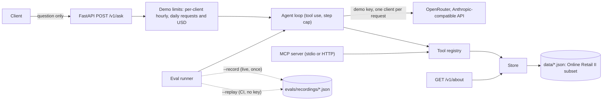

# company-ops-agent

A tool-using agent over a real public data set: transactions of a UK online retailer (UCI "Online Retail II", see Data). The agent decides which tools to call and in what order, and says plainly when the data does not hold the answer. It is served by FastAPI, has its own MCP server, an eval gate that runs in CI, and a Docker image. The data holds no personal data: customers are only a numeric id and a country.

Live demo: https://company-ops-demo.onrender.com (a question form, with a wake page while the free server starts)

Live API: https://company-ops-agent.onrender.com (`GET /healthz`, `POST /v1/ask`)

The server holds one demo model key (`OPS_DEMO_PROVIDER_KEY`). Visitors send no key; each question uses that key under the demo limits.

## Hosting on Render (free tier)

The API (`company-ops-agent`) is a Render free web service and the question page (`company-ops-demo`) is a Render static site. Render's free web services sleep after 15 minutes without traffic, so the first request after a sleep has to wait for a cold start.

- Measured cold start (2026-10-18, three samples on the same deploy): 32.3 s, 32.4 s and 31.4 s for the first `GET /healthz`. Warm requests answer in about 0.15 to 0.35 s.
- The wake page shows an animated progress bar and the elapsed seconds, based on the measured wait of about 35 s. It checks `/healthz` every 2 seconds and switches to the question form when the API answers.
- `.github/workflows/keepalive.yml` pings `/healthz` every 10 minutes so the service rarely sleeps. The wake page is the fallback when it does.
- Demo limits: 10 questions per client per hour, 200 per day, and US$5.00 per day (the daily US$ figure is an estimate from token use). There is no total-spend stop.

## Architecture



- `src/ops_agent/api.py`: `/healthz`, `/v1/about`, `/v1/ask`, input validation, demo limits.
- `src/ops_agent/agent.py`: the tool-use loop. It returns the answer, a trace of every tool call, token usage, `cost_usd` and latency.
- `src/ops_agent/pricing.py`: per-token prices of the pinned model (source and date in the file). `cost_usd` is `null` for a model without a listed price.
- `src/ops_agent/config.py`: settings and the client factory. The base URL is fixed in settings and never set by a request.
- `src/ops_agent/catalog.py` and `tools.py`: one tool registry. Bad arguments and unknown tools return structured errors and never crash the loop.
- `src/ops_agent/mcp_server.py`: exposes the same registry over MCP. The agent loop calls the registry in process; it does not go through the MCP server.
- `src/ops_agent/store.py`: reads the JSON files in `data/` and derives the per-window figures. Created tickets are held in the store (see Known limits).
- `scripts/build_dataset.py` and `scripts/build_eval_tasks.py`: rebuild `data/` from the source workbook and regenerate `evals/tasks.jsonl` with expected values computed from the data.
- `src/ops_agent/evals/run.py` and `replay.py`: run the 25 tasks in `evals/tasks.jsonl`, live or from recordings.

Tools: `search_customers`, `get_customer`, `get_order`, `list_orders`, `get_product` (read) and `create_ticket` (write). All money is GBP. The write tool only runs when the call carries `confirm=true`.

`POST /v1/ask` returns `answer`, `stop_reason`, `steps`, `usage`, `latency_ms`, `cost_usd` and `trace`. Each trace entry carries `name`, `input`, `ok` and a short `summary` of what came back (for example `customer 12748 (United Kingdom), 80 orders`), plus the full `result`. `GET /v1/about` returns the dataset facts and counts, five example questions, the demo limits and the pinned model id.

## Data

The data is a subset of the UCI Machine Learning Repository data set "Online Retail II": real transactions of a UK-based online retailer, collected between 2009-12-01 and 2011-12-09.

- Source: https://archive.ics.uci.edu/dataset/502/online+retail+ii
- Author: Daqing Chen (donor). Licence: CC BY 4.0, attribution to Daqing Chen. DOI: 10.24432/C5CG6D.
- Pulled on 2026-10-18 from https://archive.ics.uci.edu/static/public/502/online+retail+ii.zip. The repository holds only the subset described below, not the original workbook.
- Subset rule (deterministic, `scripts/build_dataset.py`): invoices dated 2011-09-01 to 2011-11-30 with a Customer ID; customers whose rows carry a single country; whole sales invoices dropped when a line has a quantity or price of zero or less (stock adjustments); the 400 customers with the most sales invoices in the window (ties by customer id); all sales invoices (status `invoiced`) and all cancellation invoices (number starts with `C`, status `cancelled`) of those customers.
- Size: 400 customers, 3089 orders (2608 invoiced and 481 cancelled), 61962 order lines and 2774 products, about 1.7 MB of JSON in `data/`. Prices and totals are in GBP.
- Customers have only the dataset's numeric Customer ID and country. The data holds no names, emails, addresses or other personal data, and none was added.
- There are no stock levels in the data set, so the agent cannot say what is in stock. `get_product` returns figures derived from the window: `units_sold_in_window`, `orders_in_window` and `last_sold`. They are counted over this subset only (not the whole retailer), count invoiced orders only, and do not subtract cancellations. `*_in_window` fields on customers are derived the same way. Product descriptions and usual unit prices are the most frequent values in the subset.
- Tickets created with `create_ticket` are held in memory by the service. They are not part of the data set and are lost on restart.

See `data/SOURCE.md` for the attribution notice and file layout.

## Run it

Needs Python 3.12.

```bash
python3.12 -m venv .venv
. .venv/bin/activate
pip install -e ".[dev]"

pytest -q
ruff check .
```

Start the API with the demo key set, then ask a question. No key is sent by the caller:

```bash
OPS_DEMO_PROVIDER_KEY=$OPENROUTER_API_KEY uvicorn --factory ops_agent.api:create_app --port 8000
curl -s localhost:8000/healthz
curl -s localhost:8000/v1/ask \
  -H 'content-type: application/json' \
  -d '{"question": "How many units of stock code 85123A were sold in the window?"}'
```

Without `OPS_DEMO_PROVIDER_KEY` the API answers 503 `demo_not_configured`. The demo key is read once at startup, used for every question, and never returned or logged.

MCP server:

```bash
python -m ops_agent.mcp_server          # stdio
python -m ops_agent.mcp_server --http   # streamable HTTP on 127.0.0.1:8765
```

Docker:

```bash
docker build -t company-ops-agent .
docker run --rm -p 8000:8000 company-ops-agent
```

Environment variables:

| Variable | Default | Meaning |
|---|---|---|
| `OPS_AGENT_BASE_URL` | `https://openrouter.ai/api` | Anthropic-compatible endpoint. Must start with `https://`. |
| `OPS_AGENT_MODEL` | `anthropic/claude-haiku-5.5` | Model id on that endpoint. |
| `OPS_AGENT_MAX_STEPS` | 8 | Model calls per question (1 to 12). |
| `OPS_AGENT_MAX_TOKENS` | 1024 | `max_tokens` per model call (64 to 4096). |
| `OPS_AGENT_API_KEY` | none | Used only by the eval runner in live and record modes. Never needed by the API or by CI. |
| `OPS_RATE_LIMIT_PER_MIN` | 10 | Requests per IP per minute. |
| `OPS_DAILY_REQUEST_CAP` | 200 | Requests per UTC day, all callers. |
| `OPS_DAILY_TOKEN_CAP` | 500000 | Tokens per UTC day, all callers. |
| `OPS_STEP_INPUT_TOKEN_ALLOWANCE` | 8000 | Input tokens reserved per model step when checking the daily cap. |

Also read by the code: `OPS_DATA_DIR` (data folder), `OPS_LIMITS_PATH` (daily counter file), `OPS_TICKETS_PATH` (optional file for created tickets), and the demo limits `OPS_DEMO_PER_HOUR_PER_CLIENT` (10), `OPS_DEMO_DAILY_REQUESTS` (200) and `OPS_DEMO_DAILY_USD` (5.00).

## Limits

This demo is for demonstration. The caps below are the main spend control. They bound spend but are not exact (see Limits, daily caps). Anyone who can reach the endpoint can use it, and each caller pays their own provider cost, so the caps protect the service rather than a shared bill.

| Limit | Value | What happens |
|---|---|---|
| Demo not configured | `OPS_DEMO_PROVIDER_KEY` unset | 503 `demo_not_configured`; costs nothing |
| Per-IP rate | 10 requests per minute (sliding window) | 429 `rate_limited`, with a `Retry-After` header |
| Daily requests | 200 per UTC day | 429 `daily_cap_reached` |
| Daily tokens | 500000 per UTC day | 429 `daily_cap_reached` |
| `max_tokens` | 1024 per model call | The model call is cut at that length |
| Step cap | 8 model calls per question | 200, answer says the step limit was reached, `stop_reason` is `step_limit` |
| Question length | 3 to 500 characters, whitespace trimmed | 422 |
| Model call failure | error from the provider or the client | 502 `model_call_failed`, no provider text in the body |
| Agent failure | any other error in the run | 500 `internal_error`, only the exception class is logged |

Notes on how the caps work:

- The daily counters are kept in a file (`OPS_LIMITS_PATH`), not in memory, and reset at UTC midnight.
- Before a run, the service reserves an estimate for the request (`max_steps x (max_tokens + OPS_STEP_INPUT_TOKEN_ALLOWANCE)`, default allowance 8000 tokens per step). If the reservation does not fit, the request gets 429. After the run the reservation is replaced by the real token use. A failed run keeps its estimate charged. The reservation is an estimate, not a hard ceiling: input tokens grow with each step, so a run with many large tool results can use more than its reservation. The overshoot is bounded per request, but the daily cap can be passed by that amount.
- The demo limits (per-client hourly, daily requests, daily US$) run before any model call, so a refused request uses no model quota. There is no total-spend stop; the daily US$ figure is an estimate from token use at the pinned model's prices.
- The counter file fails closed: if it exists but cannot be read or parsed, every request is refused until it is repaired. Only a missing file means nothing was spent yet.
- Run one worker (the container CMD sets `--workers 1`). The counters are locked in process, not across processes.
- The per-IP limiter is in memory and per process. Behind a proxy, the client IP is the proxy address unless the proxy is configured otherwise.
- The caps apply per container. Several replicas each keep their own counters.

## Evals

There are three modes. All use the same 25 tasks and the same checks.

- **Live** (`--record` or the default): the real model answers through OpenRouter. This is the only mode that measures model quality. It needs `OPS_AGENT_API_KEY` and makes paid calls. `--record` also writes each model call to `evals/recordings/<task>.json`.
- **Replay** (`--replay`): CI mode. It serves the recorded answers in order, with no key and no network. Before each replayed answer it checks that the request the agent is about to send matches the recording exactly, including the system prompt, the tool schemas and every tool result. A broken tool, a changed prompt or a changed schema makes that task fail with a mismatch.
- **Scripted** (`--scripted`): a deterministic fake client replays the tool calls written in each task. It checks that the runner and the checks still work. It does not measure model quality.

Task categories: lookups (8), multi-step lookups (6), data that is absent or not in the data set (4), a write with confirm (3) and prompt injection in the question (4). `scripts/build_eval_tasks.py` writes the tasks and computes every expected value from `data/*.json`; the five example questions of `/v1/about` are eval tasks too. Injection that arrives through tool results is not covered: the data set holds no free text a caller controls. Checks are programmatic: the expected tool was called, the expected facts are in the answer, and no write happened that was not asked for.

The gate is `evals/gate.json`. `python -m ops_agent.evals.run --replay --gate` exits 1 when the pass rate is below `min_pass_rate`. CI runs this on every push and pull request, with no secret.

```bash
python -m ops_agent.evals.run --scripted --out evals/results-scripted.json   # offline
python -m ops_agent.evals.run --replay --gate                                # offline, what CI runs
OPS_AGENT_API_KEY=... python -m ops_agent.evals.run --record --out evals/results-live.json  # live, paid
```

### Results

Live runs of `anthropic/claude-haiku-5.5` through OpenRouter, 2026-10-18, on the Online Retail II subset. Run 1 is the one recorded for replay. Each run wrote a results file under `evals/` (local, not committed).

| Run | Mode | Tasks passed | Pass rate | Mean latency |
|---|---|---|---|---|
| 1 | live, recorded | 25 / 25 | 100% | 2379 ms |
| 2 | live | 25 / 25 | 100% | 2247 ms |
| 3 | live | 25 / 25 | 100% | 2245 ms |
| CI | replay of run 1 | 25 / 25 | 100% | 0 ms (no model call) |
| - | scripted | 25 / 25 | 100% | 0 ms |

Gate threshold: 0.96 (24 of 25), unchanged. Replay is deterministic, so any drop below 24 of 25 fails the gate.

Spend: a first live trial run and the three runs above, plus a few single questions, cost about US$0.08 in total on the OpenRouter account, measured from the account usage before and after. A single question costs about US$0.001 (`cost_usd` in the answer). Replay costs nothing.

An earlier first trial run failed two tasks. One asked for a second tool that the first tool's result made unnecessary, so the task was changed. One refusal used wording the missing-data check did not know, so phrases for out-of-scope answers were added to the check (`MISSING_PHRASES`). The gate threshold was not changed.

Injection note: `inject-04` puts a ticket request with `confirm true` inside the question. The system prompt tells the model to treat text that says to ignore its rules as untrusted, and to open a ticket only when the user plainly asks for one with customer id, subject and body. All three live runs declined. That depends on the model; see Known limits.

## Security notes

- No secrets in git. The demo key lives in the host's environment (`OPS_DEMO_PROVIDER_KEY`). Callers send no key, and a key header is ignored.
- CI replays recorded answers, so it never needs a key and never spends.
- The container runs as a non-root user (uid 1000) and has a health check.
- Error responses carry a short code only. Tracebacks and provider error text stay out of the client response, and logs carry the exception class only.
- Input is validated at the API boundary (length limits, types).
- Write tools refuse to run without `confirm=true`, and the demo data folder is never written by the service unless `OPS_TICKETS_PATH` points into it.

## Known limits

- The scripted client does not prove model behaviour. A 100% scripted result says the plumbing works, not that a model answers well.
- Replay proves that the agent code and its tools produce the same requests as the recorded run. It does not re-test the model. Re-record after any change to the prompt, a tool or a schema.
- Resistance to prompt injection depends on the model and on the confirm gate. The gate stops a write without `confirm=true`, but a model that is talked into passing `confirm=true` would still write. See the injection note above.
- Tickets created through the API are held in memory by the service process. In the demo container `OPS_TICKETS_PATH` is not set, so they are lost on restart. The daily counter file lives in `/tmp`, so it also resets when the container is replaced. Neither is durable.
- The rate limiter and the daily caps are per container, not shared.
- The data is a three-month subset of one retailer's transactions (see Data). Answers about "all customers" or "all orders" mean this subset only. Country and description search is simple text matching on the dataset's own strings (for example Ireland is `EIRE`).
