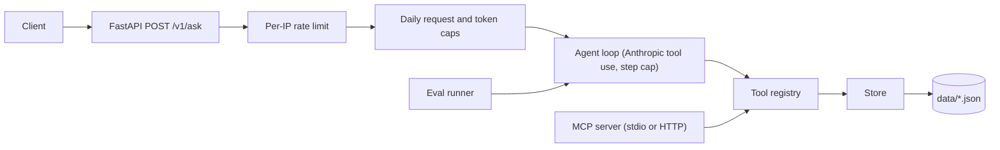

# company-ops-agent

A tool-using agent over a fictional company data set (Lumen Outdoor Co.). The agent decides which tools to call and in what order. It is served by FastAPI, has its own MCP server, an eval gate that runs in CI, and a Docker image. All data is invented. There is no real client data in this repository.

Live demo: not deployed yet

## Architecture



- `src/ops_agent/api.py`: `/healthz` and `/v1/ask`, input validation, limits.
- `src/ops_agent/agent.py`: the tool-use loop. It returns the answer, a trace of every tool call, token usage and latency.
- `src/ops_agent/catalog.py` and `tools.py`: one tool registry. Bad arguments and unknown tools return structured errors and never crash the loop.
- `src/ops_agent/mcp_server.py`: exposes the same registry over MCP. The agent loop calls the registry in process; it does not go through the MCP server.
- `src/ops_agent/store.py`: reads the JSON files in `data/`. Writes are held in the store (see Known limits).
- `src/ops_agent/evals/run.py`: runs the 25 tasks in `evals/tasks.jsonl`.

Tools: `search_customers`, `get_customer`, `get_order`, `list_orders`, `check_inventory` (read) and `create_ticket` (write). The write tool only runs when the call carries `confirm=true`.

## Run it

Needs Python 3.12.

```bash
python3.12 -m venv .venv
. .venv/bin/activate
pip install -e ".[dev]"

pytest -q
ruff check .
```

Set the environment (copy `.env.example`; the file is not read automatically, export the values):

```bash
export ANTHROPIC_API_KEY=...   # your own key, from the environment only
uvicorn --factory ops_agent.api:create_app --port 8000
curl -s localhost:8000/healthz
curl -s localhost:8000/v1/ask -H 'content-type: application/json' \
  -d '{"question": "Which city does customer C-1001 live in?"}'
```

MCP server:

```bash
python -m ops_agent.mcp_server          # stdio
python -m ops_agent.mcp_server --http   # streamable HTTP on 127.0.0.1:8765
```

Docker:

```bash
docker build -t company-ops-agent .
docker run --rm -p 8000:8000 -e ANTHROPIC_API_KEY company-ops-agent
```

Environment variables:

| Variable | Default | Meaning |
|---|---|---|
| `ANTHROPIC_API_KEY` | none | Model key. Required for live answers and live evals. |
| `OPS_AGENT_MODEL` | `claude-haiku-5-5` | Model id. |
| `OPS_AGENT_MAX_STEPS` | 8 | Model calls per question (1 to 12). |
| `OPS_AGENT_MAX_TOKENS` | 1024 | `max_tokens` per model call (64 to 4096). |
| `OPS_RATE_LIMIT_PER_MIN` | 10 | Requests per IP per minute. |
| `OPS_DAILY_REQUEST_CAP` | 200 | Requests per UTC day, all callers. |
| `OPS_DAILY_TOKEN_CAP` | 500000 | Tokens per UTC day, all callers. |
| `OPS_STEP_INPUT_TOKEN_ALLOWANCE` | 8000 | Input tokens reserved per model step when checking the daily cap. |

Also read by the code: `OPS_DATA_DIR` (data folder), `OPS_LIMITS_PATH` (daily counter file) and `OPS_TICKETS_PATH` (optional file for created tickets).

## Limits

This demo is for demonstration. The caps below are the spend control. Anyone who can reach the endpoint can use it, so keep the caps low.

| Limit | Value | What happens |
|---|---|---|
| Per-IP rate | 10 requests per minute (sliding window) | 429 `rate_limited`, with a `Retry-After` header |
| Daily requests | 200 per UTC day | 429 `daily_cap_reached` |
| Daily tokens | 500000 per UTC day | 429 `daily_cap_reached` |
| `max_tokens` | 1024 per model call | The model call is cut at that length |
| Step cap | 8 model calls per question | 200, answer says the step limit was reached, `stop_reason` is `step_limit` |
| Question length | 3 to 500 characters, whitespace trimmed | 422 |
| Agent failure | any error in the run | 500 `internal_error`, no traceback in the body |

Notes on how the caps work:

- The daily counters are kept in a file (`OPS_LIMITS_PATH`), not in memory, and reset at UTC midnight.
- Before a run, the service reserves an estimate for the request (`max_steps x (max_tokens + OPS_STEP_INPUT_TOKEN_ALLOWANCE)`, default allowance 8000 tokens per step). If the reservation does not fit, the request gets 429. After the run the reservation is replaced by the real token use. A failed run keeps its estimate charged.
- The counter file fails closed: if it exists but cannot be read or parsed, every request is refused until it is repaired. Only a missing file means nothing was spent yet.
- Run one worker (the container CMD sets `--workers 1`). The counters are locked in process, not across processes.
- The per-IP limiter is in memory and per process. Behind a proxy, the client IP is the proxy address unless the proxy is configured otherwise.
- The caps apply per container. Several replicas each keep their own counters.

## Evals

There are two modes. Both use the same 25 tasks and the same checks.

- **Live**: the real model answers. This is the only mode that measures model quality. It needs `ANTHROPIC_API_KEY` and makes paid calls.
- **Scripted**: a deterministic fake client replays the tool calls written in each task. It runs offline. It checks that the tools, the checks and the runner still work. It does not measure model quality.

Task categories: lookups, multi-step lookups, a write with confirm, a refusal when data is absent, and prompt injection inside ticket text. Checks are programmatic: the expected tool was called, the expected facts are in the answer, and no write happened that was not asked for.

The gate is `evals/gate.json`. `python -m ops_agent.evals.run --gate` exits 1 when the pass rate is below `min_pass_rate`. The current value (0.8) is a placeholder until it is set from measured live runs. CI runs the live gate and fails if the key is missing.

```bash
python -m ops_agent.evals.run --scripted --out evals/results-scripted.json   # offline
ANTHROPIC_API_KEY=... python -m ops_agent.evals.run --gate                   # live, paid
```

| Mode | Model | Tasks passed | Pass rate |
|---|---|---|---|
| Scripted (deterministic regression check) | scripted | 25 / 25 | 100% |
| Live model results: pending (the live eval has not been run; see evidence file) | | | |

## Security notes

- No secrets in git. The API key is read only from the environment. `.env.example` has an empty value.
- The container runs as a non-root user (uid 1000) and has a health check.
- Error responses carry a short code only. Tracebacks go to the server log, not to the client.
- Input is validated at the API boundary (length limits, types).
- Write tools refuse to run without `confirm=true`, and the demo data folder is never written.

## Known limits

- The scripted client does not prove model behaviour. A 100% scripted result says the plumbing works, not that a model answers well.
- Resistance to prompt injection depends on the model and on the confirm gate. The gate stops a write without `confirm=true`, but a model that is talked into passing `confirm=true` would still write. The injection tasks in the eval test this only in live mode.
- Tickets created through the API are held in memory by the service process. In the demo container `OPS_TICKETS_PATH` is not set, so they are lost on restart. The daily counter file lives in `/tmp`, so it also resets when the container is replaced. Neither is durable.
- The rate limiter and the daily caps are per container, not shared.
- The data is small and fictional. Search is simple text matching.
